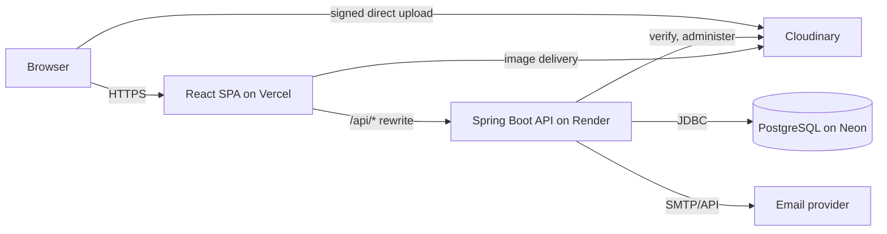

# Architecture

## 1. Status

Phase 00 establishes the repository, local infrastructure, backend, frontend, and verification pipelines. Phase 01 adds the domain schema, JPA entities, repositories, and shared DTO foundation. Phase 02 adds authentication and authorization. Phase 03 adds archive management and public read APIs. Phase 04 adds signed Cloudinary uploads, server-side asset verification, submission tracking, photographer credits, and expired-upload cleanup. Phase 05 adds the moderation state machine, user reporting, removal requests, event-suggestion review, administrative audit-log reads, and analytics. Phase 06 adds the frontend design system, application shell, session-aware API client, guarded routing, and shared UI primitives. Phase 07 adds public event filters, a contributor directory, and photographer credits to the read API, then builds the public website: home, archive, event, album, contributor, and About pages.

## 2. Architectural style

The system is a **modular monolith**:

- One Spring Boot backend organized by business domain.
- One React single-page application organized by feature.
- One PostgreSQL database.
- Cloudinary for image storage and delivery.
- No microservices, message broker, Redis, or Elasticsearch in the initial architecture.

This keeps deployment and operations simple while preserving clear module boundaries.

## 3. System context



### Request path

- Development: browser → Vite dev server (`:5173`) → `/api` proxy → Spring Boot (`:8080`).
- Production: browser → Vercel → `/api/*` rewrite → Render → Neon.
- Cloudinary uploads go directly from the browser to Cloudinary; image bytes do not pass through Spring Boot.

## 4. Backend modules

```text
com.gecarchive
├── auth
├── user
├── event
├── album
├── photo
├── moderation     photo transitions, reports, removal requests
├── category
├── contributor
├── analytics
├── audit
├── common
└── GecArchiveApplication
```

Report and removal-request governance lives in `moderation` alongside photo transitions because they share the same actors, audit conventions, and administration surface; there is no separate `report` package.

Each domain uses only the layers it needs:

- `controller`
- `service`
- `repository`
- `entity`
- `dto`
- `mapper`
- `validation`

Controllers handle HTTP concerns, validation, and authorization annotations. Services own business rules and transaction boundaries. Repositories use Spring Data JPA. DTOs define the API contract; entities never cross the HTTP boundary.

## 5. Frontend structure

```text
src/
├── app/            application shell, router, providers, route guards
├── components/ui/  design-system primitives
├── features/       feature folders such as account, auth, archive, contributions, dashboard, admin
├── lib/            API client, configuration, utilities
├── styles/         global styles and design tokens
└── test/           test setup and shared helpers
```

Features own their components, hooks, schemas, and tests. Shared components remain generic and presentation-focused. Routes are code-split, and `docs/FRONTEND.md` documents the design tokens, navigation, guards, and session behavior.

## 6. Authentication and session model

The implemented model:

- Access token: short-lived JWT, kept in memory only.
- Refresh token: opaque random token, hashed at rest, rotated on use, delivered in a secure `HttpOnly` cookie.
- Refresh-token reuse detection revokes the token family.
- Cookie-authenticated endpoints are protected against CSRF.
- Production uses a same-origin `/api` rewrite so refresh cookies remain first-party.
- No long-lived secrets in `localStorage`.

The backend design is recorded in ADR-0013 and ADR-0014; the browser implementation is recorded in ADR-0020 and documented in `docs/FRONTEND.md`.

## 7. Upload flow

1. User selects photographs.
2. Frontend validates count, size, and MIME type.
3. Frontend requests upload authorization.
4. Backend authenticates the user and creates a short-lived upload authorization.
5. Backend returns signed Cloudinary parameters.
6. Frontend uploads directly to Cloudinary.
7. Frontend submits the asset identifiers and metadata.
8. Backend verifies the asset with trusted Cloudinary APIs.
9. Backend verifies ownership and matching upload authorization.
10. Backend creates pending photo records.
11. Administrators moderate the submission.

Key rules:

- Never trust client-provided URLs, public IDs, dimensions, or MIME types.
- Pending assets must not be publicly reachable.
- Abandoned uploads expire and are cleaned up.
- Original images are exposed only where permitted.
- EXIF location data is not published.

Phase 04 uses a `CloudinaryAssetVerifier` port. Production calls the Cloudinary Admin API with server-side credentials; the test profile uses an in-memory verifier. The API never accepts client-provided dimensions, bytes, format, asset ID, or delivery type as authoritative.

## 8. Moderation architecture

- Current photo status is stored on `photo` for fast queries.
- Full moderation history is append-only.
- Transitions are enforced by the service layer.
- Optimistic locking and conditional updates prevent conflicting actions.
- Public visibility is a single, tested predicate combining photo, album, event, and soft-delete state.
- Administrative actions produce audit records.

Phase 05 implementation:

1. `UploadService` registers a `PENDING` photo and writes the opening `SUBMIT` history row.
2. `AdminModerationController` exposes the queue and the six transitions under `/api/v1/admin`, which requires `ADMIN` or `SUPER_ADMIN` at the URL level.
3. `PhotoModerationService` owns the transition table, validates album/event agreement on approval, writes the moderation and audit rows, and re-derives the submission status — all in one transaction.
4. `PhotoReportService` accepts reports only for publicly visible photographs; `PhotoRemovalRequestService` restricts requests to the uploader and reuses `PhotoModerationService` on approval so both entry points share one history format.
5. `EventSuggestionService` reviews suggestions and optionally creates an unpublished draft event through `ArchiveAdminService`.
6. `AuditLogQueryService` and `AnalyticsService` provide read-only administrative views over the append-only audit trail and status counters.
7. Every state-changing request is validated and authorized on the server; frontend guards are usability only.

## 9. Cross-cutting concerns

| Concern | Approach |
|---|---|
| API versioning | `/api/v1` |
| Error format | RFC 9457 `ProblemDetail` |
| Validation | Jakarta Bean Validation in DTOs |
| Time | UTC everywhere; `timestamptz` in PostgreSQL |
| IDs | UUID primary keys |
| Deletion | Soft delete/archival for published content; restrictive foreign keys |
| Logging | Structured, no secrets or unnecessary personal data |
| Observability | Spring Boot Actuator health/info; hosted platform logs and uptime checks |
| Caching | HTTP caching for public reads; React Query client cache; no Redis initially |
| Configuration | Environment variables; dev profile only for local defaults |

## 10. Deployment topology

| Environment | Frontend | Backend | Database | Images | Email |
|---|---|---|---|---|---|
| Local | Vite `:5173` | Spring Boot `:8080` | Docker PostgreSQL 17 | Cloudinary test account | Mailpit |
| Production | Vercel | Render | Neon PostgreSQL | Cloudinary | Production SMTP/API provider |

The production API is reached through a Vercel `/api/*` rewrite so browser cookies remain first-party.

## 11. Version policy

- Backend dependencies are managed by the Spring Boot BOM, with explicit versions only where required.
- Frontend dependencies are pinned exactly in `package.json` and locked in `package-lock.json`.
- Major framework upgrades require an ADR and a verification pass.
- TypeScript is pinned to a version supported by the current TypeScript ESLint toolchain.

See `docs/DECISIONS.md` for the accepted version matrix and rationale.

## 12. Phase boundaries

| Phase | Architectural output |
|---|---|
| 00 | Repository, toolchains, local infrastructure, security baseline |
| 01 | Database schema, entities, repositories, DTO foundation, API docs |
| 02 | Authentication, four-role authorization, ownership checks |
| 03 | Events, albums, academic years, categories, public archive APIs |
| 04 | Signed Cloudinary uploads, verification, variants, cleanup |
| 05 | Moderation, reports, event suggestions, audit logs |
| 06 | Frontend design system, navigation, API client, routing |
| 07 | Public website |
| 08 | User dashboard |
| 09 | Admin dashboard |
| 10 | Unit, integration, E2E, security, and performance verification |
| 11 | Production deployment and launch |
