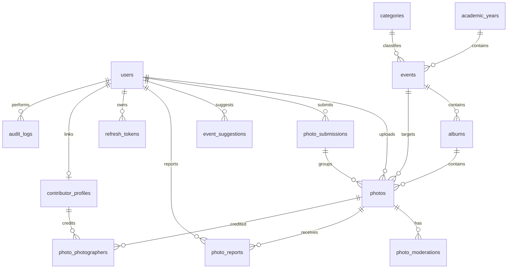

# Database

## 1. Status

Phase 00 creates only the Flyway baseline table `app_metadata`. The domain schema is designed and implemented in Phase 01.

This document records conventions, draft relationships, and integrity rules that must be resolved before entity classes are written.

## 2. Technology

- PostgreSQL 17
- Flyway migrations
- Spring Data JPA / Hibernate
- UUID primary keys
- `timestamptz` timestamps in UTC
- JSONB only where flexible structured data is genuinely useful

## 3. Naming and type conventions

| Concern | Convention |
|---|---|
| Tables | `snake_case`, plural, e.g. `photos`, `photo_moderations` |
| Columns | `snake_case`, e.g. `created_at`, `uploaded_by_user_id` |
| Primary keys | `id uuid primary key` |
| Foreign keys | `<entity>_id` |
| Timestamps | `timestamptz`, UTC |
| Soft deletion | `deleted_at timestamptz null` |
| Optimistic locking | `version bigint not null default 0` where concurrent updates matter |
| Enumerations | PostgreSQL enums or constrained `varchar` plus application enums; choose one strategy in Phase 01 |
| Unique constraints | Prefer partial unique indexes where soft-deleted rows must be ignored |

## 4. Core entity catalog

| Entity | Purpose | Key relationships |
|---|---|---|
| `users` | Accounts and roles | Uploads photos, suggests events, reports photos, owns refresh tokens |
| `refresh_tokens` | Rotating refresh-token families | Belongs to one user; hashed token value; expiry and revocation metadata |
| `academic_years` | Institutional time periods | Has many events |
| `categories` | Event classification | Has many events |
| `events` | College events | Belongs to an academic year and category; has many albums and photos |
| `albums` | Curated photo collections | Belongs to one event; has many photos |
| `photos` | Photographic records and moderation state | Belongs to an event; optionally to an album; uploaded by a user; has moderation history, photographer credits, and reports |
| `photo_moderations` | Append-only moderation history | Belongs to a photo; records actor, action, reason, prior/new state |
| `photo_reports` | User reports of inappropriate or unauthorized content | Belongs to a photo and reporter; handled by an administrator |
| `event_suggestions` | User-proposed missing events | Created by a user; reviewed by an administrator |
| `contributor_profiles` | Public photographer/contributor identities | Optionally linked to a user; credited on photos |
| `photo_photographers` | Multi-photographer attribution join | Links photos to contributor profiles with credit order/name |
| `photo_submissions` | Submission batch and tracking aggregate | Created by a user; groups photos; enforces per-submission limits |
| `audit_logs` | Append-only sensitive administrative actions | Actor snapshot, action, entity, before/after data, request metadata |

`photo_submissions` and `photo_photographers` are proposed additions required to satisfy the product rules; they are not additional roles or services. They must be reviewed in the Phase 01 ERD.

## 5. Draft relationships

## 6. Critical integrity rules

### 6.1 Uploader and photographer

- `photos.uploaded_by_user_id` identifies the accountable uploader.
- Photographer attribution lives in `photo_photographers`.
- Never derive photographer from uploader.
- Multiple photographers per photo are allowed.
- Credit name may be free text when no contributor profile exists.

### 6.2 Event and album consistency

Proposed rules:

- `photos.event_id` is required as the target event.
- `photos.album_id` is nullable while the photo is pending.
- Once approved, `photos.album_id` is required.
- A composite foreign key ensures the album belongs to the same event as the photo.
- A check constraint enforces `status <> 'APPROVED' OR album_id IS NOT NULL`.

This prevents a photo from appearing in an album belonging to a different event.

### 6.3 Moderation history

- `photo_moderations` is append-only.
- Current `photos.status` is a denormalized fast-read value, updated only through the service layer.
- Every transition writes a moderation record and an audit record.
- Conflicting concurrent actions are prevented with optimistic locking or conditional updates.
- Rejected and removed photographs never appear in public queries.

### 6.4 Soft deletion

- Published content uses `deleted_at` or an archived state.
- Foreign keys default to `ON DELETE RESTRICT`.
- Do not cascade-delete published events, albums, photos, or audit history.
- Users are deactivated or anonymized rather than hard-deleted while attribution and audit records must remain intact.

### 6.5 Audit records

- `audit_logs` is append-only.
- Store actor ID where available plus an actor snapshot for historical clarity.
- Store action, entity type, entity ID, prior/new state, timestamp, IP, and user agent where appropriate.
- Never store passwords, tokens, or secrets.

## 7. Indexing plan

Indexes will be added with the queries that need them, including:

- `users (lower(email))` unique where not deleted.
- `events (academic_year_id, event_date)`.
- `events (category_id, event_date)`.
- `albums (event_id, published, deleted_at)`.
- `photos (status, deleted_at)`.
- `photos (album_id, status, sort_order)`.
- `photos (event_id, status)`.
- `photos (uploaded_by_user_id, created_at desc)`.
- `photo_moderations (photo_id, created_at desc)`.
- `photo_reports (status, created_at)`.
- `event_suggestions (status, created_at)`.
- `refresh_tokens (token_hash)` unique.
- `audit_logs (created_at desc)` and `(entity_type, entity_id)`.

Use `EXPLAIN ANALYZE` for expensive public gallery and search queries. Do not add indexes speculatively.

## 8. Migration policy

- Every schema change is a Flyway migration.
- Migrations are forward-only in production.
- Never edit an applied migration.
- Never use `hibernate.ddl-auto=update`.
- `ddl-auto=validate` runs in deployed environments.
- Destructive migrations require a documented backup and rollback plan.
- Seed data is separated from schema migrations where possible.

## 9. Open Phase 01 questions

1. PostgreSQL enum versus constrained `varchar` for roles, statuses, and report states.
2. Exact `photo_submissions` aggregate shape and whether moderation is per photo or per submission batch.
3. Whether albums can be created before approval or only during moderation.
4. Whether `events` can exist without a published album.
5. How removed content is retained for audit while remaining inaccessible publicly.
6. Contributor profile ownership, claiming, and moderation.
7. Academic year uniqueness and event-date validation.
8. Audit actor handling when a user is deactivated or anonymized.
9. Report categories and resolution workflow.
10. Retention policy for originals, rejected uploads, and removed photographs.
