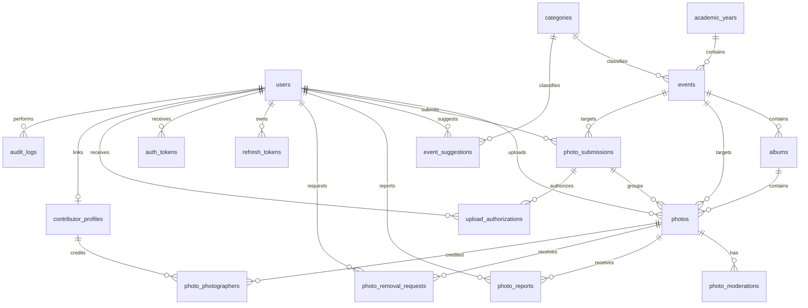

# Database

## 1. Status

Phase 01 defines the domain schema, JPA entities, repositories, and shared DTO foundation. Phase 02 adds authentication schema and security state. Phase 03 activates archive management and public reads. Phase 04 adds upload authorization state and activates submission/photo registration through trusted Cloudinary verification. Moderation remains a later phase.

Flyway migrations are the only source of schema truth. Hibernate runs with `ddl-auto=validate`; it never creates or alters tables.

## 2. Technology

- PostgreSQL 17
- Flyway migrations
- Spring Data JPA / Hibernate 7
- UUID primary keys
- `timestamptz` timestamps in UTC
- JSONB for append-only audit snapshots
- Constrained `varchar` columns mapped to Java enums

## 3. Naming and type conventions

| Concern | Convention |
|---|---|
| Tables | `snake_case`, plural, e.g. `photos`, `photo_moderations` |
| Columns | `snake_case`, e.g. `created_at`, `uploaded_by_user_id` |
| Primary keys | `id uuid primary key default gen_random_uuid()` |
| Foreign keys | `<entity>_id` |
| Timestamps | `timestamptz`, UTC |
| Soft deletion | `deleted_at timestamptz null` |
| Optimistic locking | `version bigint not null default 0` where concurrent updates matter |
| Enumerations | Constrained `varchar` plus `CHECK` constraint and a Java enum |
| Unique constraints | Prefer partial unique indexes where soft-deleted rows must be ignored |

### Enumeration strategy

PostgreSQL enum types are not used. Every enumeration is stored as a constrained `varchar`:

- Adding a value requires a forward-only migration and a matching Java enum constant.
- Values remain readable in SQL and exports.
- Hibernate maps enums with `@Enumerated(EnumType.STRING)`.
- The database rejects values that are not in the current allowlist.

## 4. Core entity catalog

| Entity | Purpose | Key relationships |
|---|---|---|
| `users` | Accounts, roles, and status | Uploads photos, suggests events, reports photos, owns refresh tokens and auth tokens |
| `refresh_tokens` | Rotating refresh-token families | Belongs to one user; hashed token value; idle expiry, family expiry, and revocation metadata |
| `auth_tokens` | Single-use email verification and password reset tokens | Belongs to one user; hashed token value, purpose, expiry, and usage timestamp |
| `academic_years` | Institutional time periods | Has many events |
| `categories` | Event classification | Has many events and event suggestions |
| `events` | College events | Belongs to an academic year and category; has many albums and photos |
| `albums` | Curated photo collections | Belongs to one event; has many photos |
| `photo_submissions` | Submission batch and tracking aggregate | Created by a user; targets one event and optionally an album |
| `photos` | Photographic records and moderation state | Belongs to an event; optionally to an album and submission; uploaded by a user |
| `upload_authorizations` | Short-lived, single-use signed upload grants | Belongs to one user and submission; stores only signature/public-ID metadata |
| `photo_moderations` | Append-only moderation history | Belongs to a photo; records actor, action, reason, prior/new state |
| `photo_reports` | User reports of inappropriate or unauthorized content | Belongs to a photo and reporter; handled by an administrator |
| `photo_removal_requests` | Owner-initiated takedown requests | Belongs to a photo and requester; handled by an administrator |
| `event_suggestions` | User-proposed missing events | Created by a user; reviewed by an administrator |
| `contributor_profiles` | Public photographer/contributor identities | Optionally linked to a user; credited on photos |
| `photo_photographers` | Multi-photographer attribution join | Links photos to contributor profiles with credit order/name |
| `audit_logs` | Append-only sensitive administrative actions | Actor snapshot, action, entity, before/after data, request metadata |

`photo_submissions` and `photo_photographers` are required domain tables. They are not additional roles or services.

## 5. Relationships

## 6. Integrity rules

### 6.1 Uploader and photographer

- `photos.uploaded_by_user_id` identifies the accountable uploader.
- Photographer attribution lives in `photo_photographers`.
- Never derive photographer from uploader.
- Multiple photographers per photo are allowed through ordered credit rows.
- `credit_name` is always stored, allowing free-text credit when no profile exists.
- A photo should have at least one photographer credit. This is enforced by the service layer because it spans multiple rows.

### 6.2 Event and album consistency

- `photos.event_id` is required.
- `photos.album_id` is nullable while a photo is pending.
- Once approved, `photos.album_id` is required.
- A composite foreign key `(album_id, event_id)` ensures the album belongs to the photo's event.
- A check constraint enforces `status <> 'APPROVED' OR album_id IS NOT NULL`.
- Albums are created and published by administrators.
- Users may target an existing album during submission but cannot create albums.
- Events may exist before any album is created.
- Pending photos may belong to a submission whose preferred album is null.

### 6.3 Moderation

- Moderation is recorded per photo. A submission batch is only a tracking and limit aggregate.
- `photo_moderations` is append-only, enforced by database triggers as well as application discipline.
- Current `photos.status` is a denormalized fast-read value, updated only through the service layer.
- Every transition writes a moderation record and an audit record.
- Conflicting concurrent actions are prevented with optimistic locking or conditional updates.
- `FLAGGED`, `HIDDEN`, and `REMOVED` photographs never appear in public queries.
- A batch's status is derived and maintained by the service layer; it never replaces per-photo state.

### 6.4 Soft deletion and public visibility

- Published content uses `deleted_at` for archival removal.
- Foreign keys default to `ON DELETE RESTRICT`.
- Do not cascade-delete published events, albums, photos, or audit history.
- Users are deactivated or anonymized rather than hard-deleted while attribution and audit records must remain.
- Removed photographs keep their metadata for audit and attribution but are never publicly reachable.

A photo is publicly visible only when all of the following hold:

1. `photos.status = 'APPROVED'`
2. `photos.deleted_at IS NULL`
3. `photos.album_id IS NOT NULL`
4. The album is published and not deleted.
5. The album's event is published and not deleted.

Public APIs must apply this predicate consistently once domain endpoints are implemented in Phase 03.

### 6.5 Audit records

- `audit_logs` is append-only, enforced by database triggers.
- Store the actor ID where available plus an actor display-name and role snapshot.
- Store action, entity type, entity ID, prior/new JSONB state, timestamp, IP, and user agent where appropriate.
- Never store passwords, tokens, or secrets.
- Deactivated users remain referenced so historical audit rows stay valid.

### 6.6 Reports and removal requests

- Reports and removal requests are available only to authenticated `USER`, `ADMIN`, and `SUPER_ADMIN` accounts.
- A user cannot submit more than one open report for the same photo.
- A user cannot submit more than one open removal request for the same photo.
- Resolved and dismissed records remain for audit.
- Handling a report or removal request produces an audit record.
- Guest reporting is intentionally deferred until abuse controls and rate limiting exist.

### 6.7 Authentication data (Phase 02)

`refresh_tokens`:

- `token_hash` stores only the SHA-256 hex digest of a 256-bit opaque value; raw values are never persisted.
- `family_id` groups all rotations of one login session.
- `expires_at` is the idle expiry; `family_expires_at` is the absolute session deadline and never extends across rotations.
- `family_expires_at >= expires_at` is enforced by a check constraint.
- `revoked_at` plus `revocation_reason` record logout, rotation, reuse detection, password change, role change, and account-status revocation.

`auth_tokens`:

- `purpose` is constrained to `EMAIL_VERIFICATION` or `PASSWORD_RESET`.
- `token_hash` is a unique SHA-256 hex digest; raw tokens exist only in outbound email.
- `expires_at > created_at` is enforced, and `used_at` makes every token single-use.
- Issuing a new token for the same user and purpose invalidates the previous unused token in the service layer.
- Foreign key to `users` uses `ON DELETE RESTRICT`, preserving audit history.

`users.password_change_required`:

- Defaults to `false`.
- Set to `true` for the environment-bootstrapped first SUPER_ADMIN.
- Cleared on password change or password reset.
- When true, the API blocks every endpoint except profile read, password change, CSRF, refresh, and logout.

`upload_authorizations`:

- Stores a server-generated Cloudinary `public_id`, signature, timestamp, expiry, user, and submission.
- It does not store raw image bytes, URLs, client metadata, or Cloudinary secrets.
- `used_at` makes an authorization single-use at the application transaction boundary.
- Expired unused rows are cleaned up after a best-effort Cloudinary asset deletion.
- The user/submission foreign keys preserve ownership and prevent cross-account attachment.

## 7. Enumerations

| Enum | Stored values |
|---|---|
| `Role` | `USER`, `ADMIN`, `SUPER_ADMIN` (application-only `GUEST`) |
| `UserStatus` | `PENDING_VERIFICATION`, `ACTIVE`, `SUSPENDED`, `DEACTIVATED` |
| `PhotoStatus` | `PENDING`, `APPROVED`, `REJECTED`, `FLAGGED`, `HIDDEN`, `REMOVED` |
| `SubmissionStatus` | `PENDING`, `IN_REVIEW`, `COMPLETED`, `WITHDRAWN` |
| `ModerationAction` | `SUBMIT`, `APPROVE`, `REJECT`, `FLAG`, `HIDE`, `REMOVE`, `RESTORE` |
| `ReportCategory` | `INAPPROPRIATE`, `COPYRIGHT`, `PRIVACY`, `MISATTRIBUTION`, `OTHER` |
| `ReportStatus` | `PENDING`, `UNDER_REVIEW`, `RESOLVED`, `DISMISSED` |
| `SuggestionStatus` | `PENDING`, `APPROVED`, `REJECTED` |
| `RemovalRequestStatus` | `PENDING`, `APPROVED`, `REJECTED` |

`GUEST` is never persisted as a user role.

## 8. Indexing plan

Phase 01 creates indexes for known access paths:

- `users (lower(email))` unique.
- `refresh_tokens (token_hash)` unique, `(user_id)`, `(family_id)`.
- `auth_tokens (token_hash)` unique.
- `auth_tokens (user_id, purpose, created_at desc)`.
- `auth_tokens (expires_at)` where `used_at IS NULL`.
- `events (academic_year_id, event_date)`.
- `events (category_id, event_date)`.
- `events (published, event_date desc)` where not deleted.
- `albums (event_id, published, deleted_at)`.
- `albums (id, event_id)` unique for composite integrity.
- `photo_submissions (submitted_by_user_id, created_at desc)`.
- `photo_submissions (status, created_at)`.
- `photos (status, deleted_at)`.
- `photos (album_id, status, sort_order)`.
- `photos (event_id, status)`.
- `photos (uploaded_by_user_id, created_at desc)`.
- `photos (event_id, album_id, sort_order)` where approved and not deleted.
- `photo_moderations (photo_id, created_at desc)`.
- `photo_reports (status, created_at)`.
- `photo_reports (photo_id, reported_by_user_id)` unique where open.
- `photo_removal_requests (status, created_at)`.
- `photo_removal_requests (photo_id, requested_by_user_id)` unique where pending.
- `event_suggestions (status, created_at)`.
- `event_suggestions (suggested_by_user_id, created_at desc)`.
- `audit_logs (created_at desc)`.
- `audit_logs (entity_type, entity_id)`.
- `audit_logs (actor_user_id, created_at desc)`.

Use `EXPLAIN ANALYZE` for expensive public gallery and search queries. Do not add indexes speculatively.

## 9. Migration policy

- Every schema change is a Flyway migration.
- Migrations are forward-only in production.
- Never edit an applied migration.
- Never use `hibernate.ddl-auto=update`.
- `ddl-auto=validate` runs in deployed environments.
- Destructive migrations require a documented backup and rollback plan.
- Seed data is separated from schema migrations where possible.
- Append-only tables reject `UPDATE` and `DELETE` in the database.

## 10. Resolved Phase 01 decisions

1. **Enumerations:** constrained `varchar` plus Java enums. No PostgreSQL enum types.
2. **Moderation unit:** per photo. Submission batches group photos for limits, tracking, and UI, but never replace photo-level state.
3. **Album lifecycle:** administrators create albums independently of submissions. Users may target an existing album; approval requires one. Events may exist without albums.
4. **Removal retention:** removed content keeps metadata and attribution, sets `deleted_at`, and loses public visibility. Cloudinary asset deletion follows the retention plan implemented in Phase 04.
5. **Contributor governance:** profiles are administrator-managed and optionally linked to a user. Self-claiming is deferred.
6. **Academic years:** labels are unique and date ranges must satisfy `start_date < end_date`. Event dates are validated against the academic year in the service layer in Phase 03.
7. **Audit actors:** the actor ID is retained with display-name and role snapshots. Users are deactivated rather than hard-deleted.
8. **Reports:** authenticated users only; open duplicates are prevented by partial unique indexes.
9. **Removal requests:** separated from reports so takedown workflow and reporting analytics stay distinct.

## 11. Resolved Phase 02 decisions

1. **Refresh storage:** opaque 256-bit tokens hashed with SHA-256; no raw refresh value is stored.
2. **Family expiry:** each refresh-token family has a fixed absolute deadline (`family_expires_at`); rotation only shortens the idle expiry.
3. **Reuse detection:** using an already-rotated token revokes the whole family in an independent transaction so the revocation survives the failed request.
4. **Verification and reset tokens:** a dedicated `auth_tokens` table with purpose, single-use `used_at`, and hashed values. Previous unused tokens for the same purpose are invalidated on reissue.
5. **Forced rotation:** `users.password_change_required` drives API-wide enforcement until the bootstrap account changes its password.
6. **Audit coverage:** registration, email verification, password reset/change, role changes, status changes, and bootstrap are recorded in `audit_logs`.

## 12. Remaining questions for later phases

1. Exact Cloudinary asset class and private-to-public delivery behavior (Phase 04).
2. Retention duration for originals, rejected uploads, and removed photographs (Phase 04/05).
3. Contributor claiming and profile-edit permissions (Phase 08).
4. Production backup, restore, and archival procedure (Phase 11).
5. Whether guest reporting is introduced after rate limiting and abuse controls (Phase 05/10).
